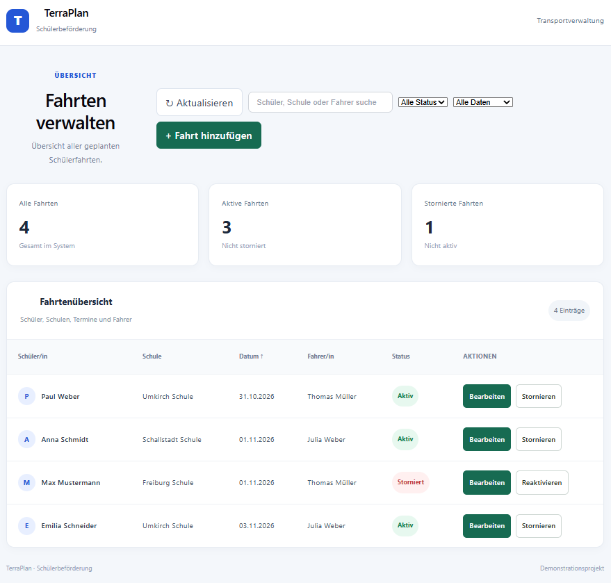
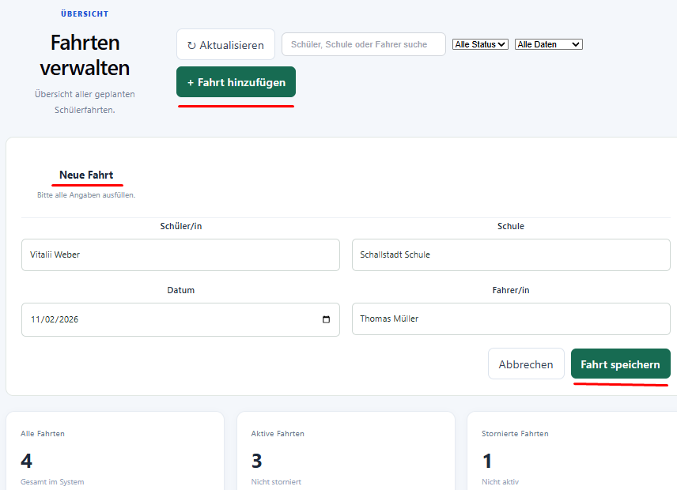
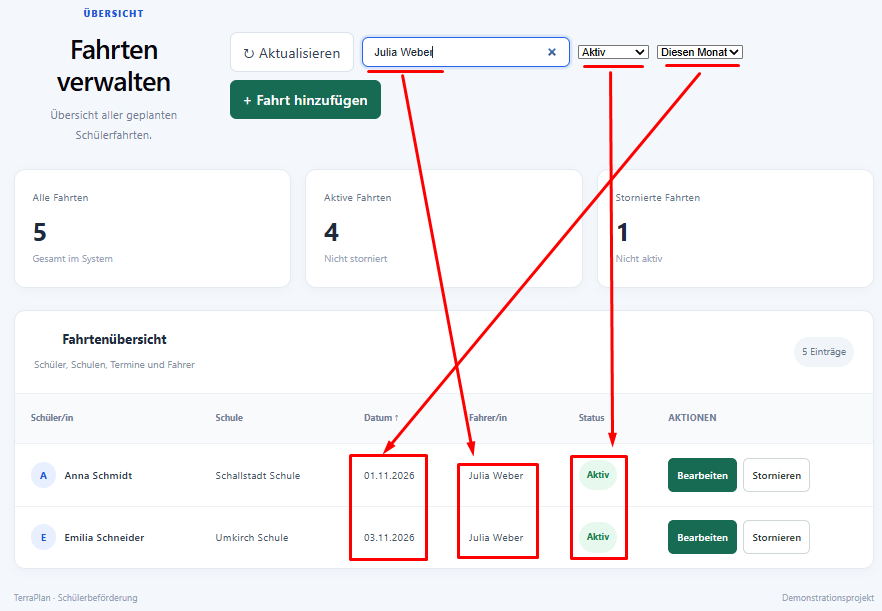
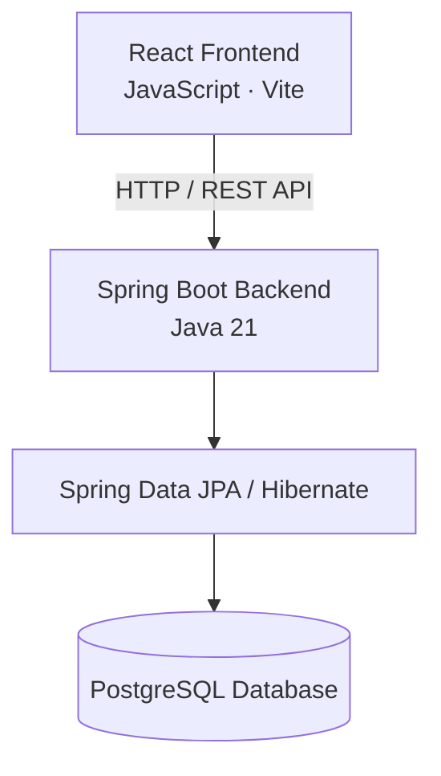

# TerraPlan – Schülerbeförderung

**TerraPlan** ist eine Full-Stack-Demoanwendung zur Planung und Verwaltung individueller Schülerfahrten.

Das Projekt demonstriert die Entwicklung einer webbasierten Anwendung mit einer REST-API, einer React-Benutzeroberfläche und einer relationalen PostgreSQL-Datenbank.

## Screenshots

### Dashboard



### Neue Fahrt anlegen



### Fahrtenübersicht und Filter



## Funktionen

- Übersicht aller Schülerfahrten
- Neue Fahrten anlegen
- Bestehende Fahrten bearbeiten
- Fahrten stornieren und reaktivieren
- Fahrten nach Datum, Schüler, Schule und Fahrer sortieren
- Suchfunktion nach Schüler, Schule und Fahrer
- Filterung nach Fahrtstatus
- Datumsfilter: alle Daten, heute, aktuelle Woche und aktueller Monat
- Persistente Speicherung in PostgreSQL

## Technologie-Stack

### Backend

- Java 21
- Spring Boot
- Spring Data JPA
- Hibernate
- PostgreSQL
- Maven
- REST API

### Frontend

- React
- JavaScript
- Vite
- HTML5
- CSS3

## Architektur

Die Anwendung basiert auf einer klassischen Client-Server-Architektur:



**Komponenten:**

- **Frontend:** React-basierte Benutzeroberfläche zur Verwaltung der Schülerfahrten.
- **Backend:** Spring Boot REST API für Geschäftslogik und Datenverarbeitung.
- **Persistence:** Spring Data JPA und Hibernate für den Datenbankzugriff.
- **Datenbank:** PostgreSQL zur persistenten Speicherung der Fahrtdaten.

Die Kommunikation zwischen Frontend und Backend erfolgt über HTTP-basierte REST-Endpunkte.

## Projektstruktur

```text
school-transport-planner/
├── frontend/
│   ├── public/
│   ├── src/
│   │   ├── assets/
│   │   ├── App.jsx
│   │   ├── App.css
│   │   ├── index.css
│   │   └── main.jsx
│   ├── index.html
│   ├── package.json
│   ├── package-lock.json
│   └── vite.config.js
├── src/
│   ├── main/
│   │   ├── java/de/terraplan/schooltransport/
│   │   └── resources/
│   │       └── application.properties
│   └── test/
├── .gitignore
├── .gitattributes
├── pom.xml
├── mvnw
├── mvnw.cmd
└── README.md
```

## Voraussetzungen

- Java 21
- Node.js und npm
- PostgreSQL

## Lokale Installation und Start

### 1. Datenbank vorbereiten

Eine PostgreSQL-Datenbank mit dem Namen `school_transport` erstellen.

### 2. Backend konfigurieren

Die Datenbankverbindung wird über Umgebungsvariablen konfiguriert:

```powershell
$env:DB_URL = "jdbc:postgresql://localhost:5432/school_transport"
$env:DB_USERNAME = "postgres"
$env:DB_PASSWORD = "YOUR_PASSWORD"
```

### 3. Backend starten

Im Projektverzeichnis:

```powershell
.\mvnw.cmd spring-boot:run
```

Das Backend ist anschließend unter folgender Adresse erreichbar:

`http://localhost:8081`

### 4. Frontend starten

Ein neues Terminal öffnen:

```powershell
cd frontend
npm install
npm run dev
```

Das Frontend ist anschließend unter folgender Adresse erreichbar:

`http://localhost:5173`

## REST API

| HTTP-Methode | Endpunkt | Beschreibung |
|---|---|---|
| GET | `/api/trips` | Alle Fahrten abrufen |
| GET | `/api/trips/active` | Aktive Fahrten abrufen |
| POST | `/api/trips` | Neue Fahrt erstellen |
| PUT | `/api/trips/{id}` | Fahrt bearbeiten |
| PATCH | `/api/trips/{id}/status?cancelled=true` | Fahrt stornieren |
| PATCH | `/api/trips/{id}/status?cancelled=false` | Fahrt reaktivieren |

## Datenbank

Die Anwendung verwendet PostgreSQL zur persistenten Speicherung der Fahrtdaten.

Die Datenbanktabellen werden durch Hibernate/JPA verwaltet.

Die Schema-Strategie kann über die Umgebungsvariable `DB_DDL_AUTO` konfiguriert werden. Für eine lokale Entwicklungsumgebung wird standardmäßig `update` verwendet. Für eine bestehende Produktionsdatenbank kann `validate` eingestellt werden.

## Projektziel

TerraPlan ist ein Demonstrationsprojekt zur Verbindung von Backend-Entwicklung, Frontend-Entwicklung und relationaler Datenhaltung.

Der Schwerpunkt liegt auf einer klaren REST-Architektur, der Verwaltung von Geschäftsprozessen und einer benutzerfreundlichen Oberfläche.